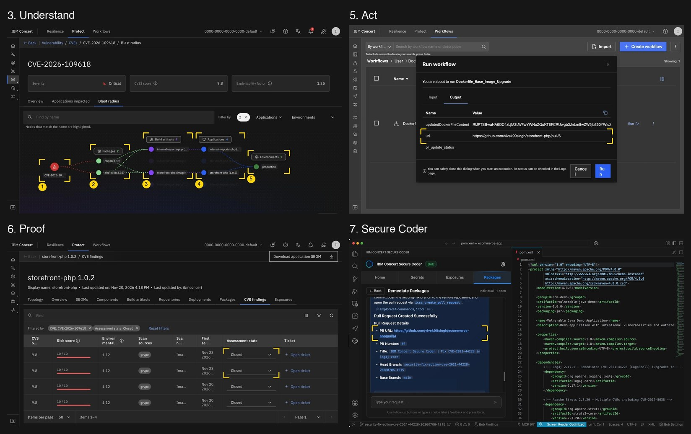
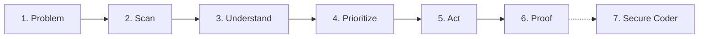
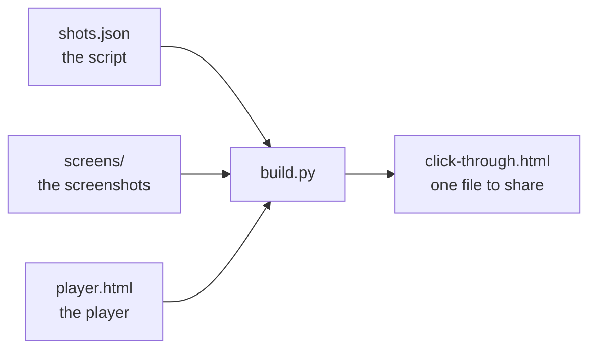

# PHP2SHELL click-through: IBM Concert demo

**A recorded, clickable demo of IBM Concert, plus a small kit to build your own.**

The demo was made for the IBM Concert webinar *Turn IT risk into action* (2 December 2026). It follows one critical vulnerability from the advisory to a merged fix and a closed finding, in 41 real screens and about 14 minutes.



<sub>The yellow corners show the presenter where to click. In the demo they pulse.</sub>

| I want to… | Go to |
|---|---|
| **Watch the demo** | [Watch it in 1 minute](#watch-it-in-1-minute) |
| **Present it** in a meeting or webinar | [Present it](#present-it) |
| **Know what the demo shows** | [The story](#the-story) |
| **Change** a screen or the script | [Change this demo](#change-this-demo) |
| **Build my own** click-through | [Build your own click-through](#build-your-own-click-through) |

---

## What is a click-through?

A click-through looks like a live demo, but nothing can break. It is a series of real screenshots from a real run:

- A **highlight** on each screen shows where to click. Clicking it goes to the next screen.
- **Speaker notes** (press **N**) say what to tell the audience.
- Everything is in **one HTML file**. It works offline, with no server, login or VPN.

Use it as a safe backup for a live demo, as the demo itself, or as something people can click through on their own.

---

## Watch it in 1 minute

1. Download **`click-through.html`**. Either:
   - open [`click-through.html`](click-through.html) here and click **Download raw file** (⤓), or
   - click **Code → Download ZIP** at the top of this page and unzip it.
2. Open the file in **Chrome, Edge or Safari**.
3. Press **→** or click the highlight to move on. Press **N** to read what the presenter says.

> GitHub does not run HTML files, so clicking the file here shows only a "file too big" message or its code. Download it first.

---

## Present it

| Key | What it does |
|---|---|
| **→** or click the highlight | Next step |
| **←** | Back |
| **N** | Speaker notes: what to say on this screen |
| **Home** | First screen |
| **?** | Help |
| **E** | Edit mode, for authors (see [step 4](#step-4-set-the-highlights)) |

- The buttons at the top jump straight to a scene.
- Every screen has its own address: `click-through.html#31` opens screen 31.
- **Close the notes before you share your screen,** or the audience sees them. Keep them on a second screen or on paper.
- Make the browser full screen (**⌃⌘F** on Mac, **F11** on Windows) so the screenshots are as large as possible.

---

## The story

A critical PHP vulnerability, **PHP2SHELL (CVE-2026-109618)**, hits two applications. IBM Concert finds them, ranks them by business risk, opens a fix, and closes the finding once the fix is deployed.



| Scene | Screens | What the audience sees |
|---|---|---|
| **1. Problem** | 1–2 | PHP2SHELL is critical, and the fix is PHP 8.3.36. The storefront app runs an affected version. |
| **2. Scan** | 3–6 | Every push builds the container image, scans it, and sends the results to IBM Concert. |
| **3. Understand** | 7–10 | Concert Protect: one CVE, two applications, the blast radius, and the fixed version. |
| **4. Prioritize** | 11–12 | Same CVE, different risk: the storefront scores 10, internal reports 4.7, because of business context. |
| **5. Act** | 13–22 | A ticket goes to the owner, and a Concert workflow opens a pull request with scan evidence. |
| **6. Proof** | 23–27 | Merge, rebuild and redeploy. The next scan no longer finds the CVE, so Concert closes the finding, and the ticket is closed. |
| **7. Secure Coder** | 28–41 | Shift left: IBM Concert Secure Coder, inside IBM Bob, fixes Log4Shell in a Java app before it ships, from the scan to the merged pull request and the rescan. |

**Where it was recorded:** IBM TechZone, IBM Concert 3.1.0, and the GitHub repositories `storefront-php` and `ecommerce-app`, on 25 and 26 November 2026.

**Honest about edits:** every screen is from a real run. A few were lightly cleaned for clarity: an old commit message hidden, a toast or floating button removed, an inaccurate table in a generated pull request description hidden. No result was changed.

---

## How it works



`build.py` puts every screenshot into the page as an image, together with the script and the player, so the result is a single file.

### What is in this folder

| File | What it is |
|---|---|
| **`click-through.html`** | The finished demo. **The only file you need to share.** |
| `shots.json` | The script: one entry per screen, with what to click and what to say. |
| `screens/` | The screenshots, named `<id>.png`, one per entry in `shots.json`. |
| `player.html` | The player template: layout, keys and highlight. |
| `build.py` | Builds `click-through.html` from the three above. |
| `deck.json` | Settings: the title and the output file name. |
| `SHOT-LIST.md` | All screens in a list, with what to click on each. |
| `docs/` | Pictures for this README. |

---

## Change this demo

| To… | Do this |
|---|---|
| Change what to say or click | Edit the `say` or `do` text in `shots.json`. |
| Replace a screenshot | Save the new picture as `screens/<id>.png`, with the same name. If the layout moved, set the highlight again ([step 4](#step-4-set-the-highlights)). |
| Remove a screen | Delete its entry in `shots.json`. |
| Reorder screens | Move entries in `shots.json`. Screens play in file order. |
| Rename or add a scene | Change the `scene` text. It sets the buttons at the top. |

Then rebuild:

```bash
python3 build.py
```

---

## Build your own click-through

You need Python 3 and a browser. Plan on about a day for a 15-minute demo: half for the run and the capture, half for the script and rehearsal.

### Step 1: Start a new folder

Copy `player.html` and `build.py` into a new folder, create an empty `screens/` folder, and add a `deck.json`:

```json
{ "title": "My product: first demo", "out": "click-through.html" }
```

### Step 2: Write the script before you capture

Decide the story first: the problem, 4–7 scenes, and the one thing each scene must land. Then list the screens in `shots.json`:

```json
[
  {
    "scene": "1. Problem",
    "id": "01-advisory",
    "capture": "The advisory page, with Critical and the fixed version visible",
    "do": "Point at Critical and 8.3.36.",
    "say": "This is PHP2SHELL, a critical remote code execution vulnerability in PHP.",
    "hotspot": [2.5, 36.22, 71.25, 21.11],
    "mark": "#d9480f"
  }
]
```

| Field | Meaning |
|---|---|
| `scene` | Scene name. Screens with the same scene share one button. Number it (`"1. Problem"`). |
| `id` | File name of the screenshot in `screens/`, without `.png`. Number it (`01-…`) so files sort in order. |
| `capture` | A note for whoever takes the screenshot: what must be visible. |
| `do` | What the presenter clicks. Shown at the bottom of the screen. |
| `say` | What the presenter says. Shown with **N**. Write it to be spoken: 15–25 seconds per screen. |
| `hotspot` | `[left, top, width, height]` of the highlight, in **percent** of the screenshot. `null` for none. |
| `mark` | Highlight colour: `#ffd60a` (yellow) on dark screens, `#d9480f` (orange) on light ones. |
| `steps` | Optional. Several highlights on one screen, shown one after another. A list of hotspots, used instead of `hotspot`. |

> **Tip:** build now, before you have any screenshots. Missing screens show as placeholders with their `capture` text, so you can rehearse the flow first.

### Step 3: Capture the screens

- **Use one size for every screen: 1600 × 900 (16:9).** Highlights are stored in percent, so the size must not change.
- **Make it sharp.** Capture on a Retina screen, or zoom the page to 125–150 %, so the text is readable when shared over Teams or Zoom.
- **One idea per screen.** Scroll so the thing to click is in view and nothing important is cut off.
- **Clean up first.** Close toasts and pop-ups, hide notifications, use a demo account, and blank out personal data, tokens and internal URLs.
- **Use a real run.** Do the whole flow for real and capture each step as it happens. Do not mock results: the audience will ask questions.

Save each picture as `screens/<id>.png`.

### Step 4: Set the highlights

1. Run `python3 build.py` and open `click-through.html`.
2. Go to the screen and press **E** (edit mode).
3. Drag a box over the area to click. The bar at the bottom shows `"hotspot": [l, t, w, h]` and copies it.
4. Paste it into that screen's entry in `shots.json`, and press **E** again to leave edit mode.
5. Run `python3 build.py` again.

### Step 5: Rehearse and time it

- Read the `say` text aloud with a timer. 130–150 spoken words is about a minute, plus 3–5 seconds per click.
- The last line of each scene should lead into the next one.
- Rehearse with **N** open, and present with it closed.

### Step 6: Share it

Share **only `click-through.html`**: on Box, a shared drive, Slack or by email. It is one file of about 10–15 MB, and it opens in any browser with nothing to install. To point someone at one screen, add `#<number>` to the end of the link.

---

## Requirements and options

- **Python 3.8 or later.** Nothing else is required.
- To shrink the screenshots, `build.py` uses **Pillow** (`pip install pillow`) if it is installed, macOS `sips` if not, and otherwise embeds the files as they are, which makes the HTML larger.

```bash
python3 build.py --title "My demo" --out my-demo.html --max-width 2000
```

| Option | What it does |
|---|---|
| `--title` | Title in the browser tab and the header. |
| `--out` | Output file name. |
| `--max-width` | Shrink wider screenshots to this width (default 2000). |
| `--fragment` | Leave out `<!doctype>` and `<html>`, for hosts that wrap the page themselves. |

---

## Troubleshooting

| Problem | Fix |
|---|---|
| GitHub shows code or "file too big" | Download the file and open it from your computer ([Watch it](#watch-it-in-1-minute)). |
| A highlight is in the wrong place | The screenshot size changed. Set it again with **E** ([step 4](#step-4-set-the-highlights)). |
| A screen shows "Screenshot needed" | `screens/<id>.png` is missing or named differently from its `id`. |
| Keys do nothing | Click once on the page so it has focus. |
| The file is very large | Install Pillow, or lower `--max-width`. |
